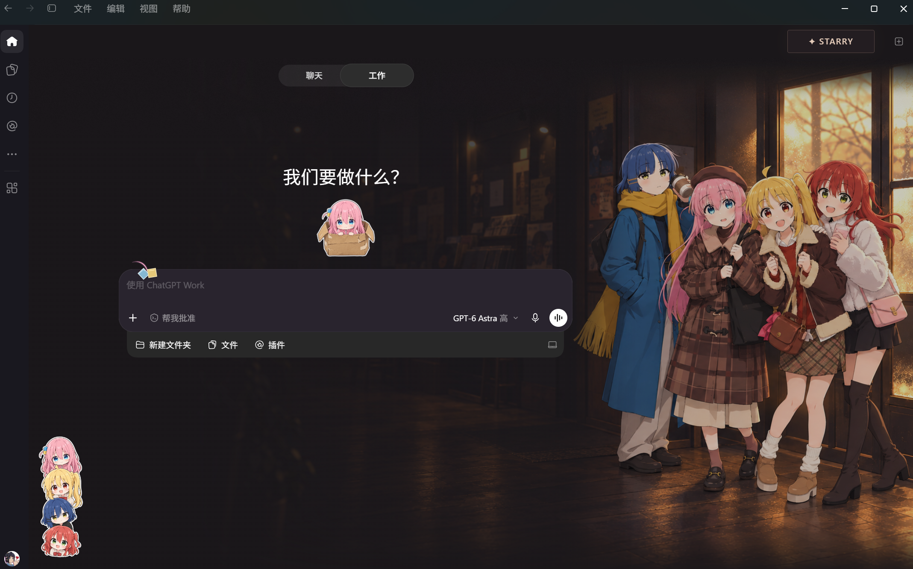
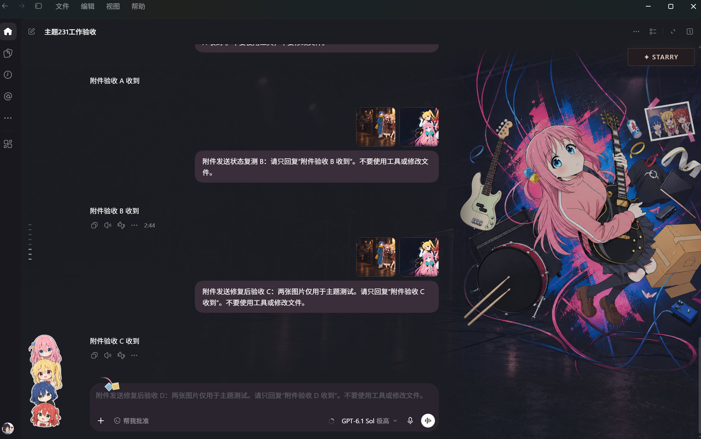

# Bocchi the Rock! · Codex Desktop Theme

**[简体中文](README.md) · English**

Bring a little of Kessoku Band’s backstage world into your everyday chats and work. This unofficial **Bocchi the Rock! anime theme for OpenAI Codex Desktop on Windows** includes six wallpapers, a STARRY wallpaper picker and character stickers, with space to keep your conversations readable.

**[Download for Windows](https://github.com/Eltamako/bocchi-codex-theme/releases/latest)** · [Install guide](docs/en/install.md) · [Troubleshooting](docs/en/troubleshooting.md) · [Upgrade or restore](docs/en/upgrade-restore.md)

> **2.6.2 supports Windows x64, Codex app 26.1016.51333 / package 26.1016.6573.0.** Setup checks the version. The theme temporarily uses dark appearance when active, whether your preference is Light, Dark or System. Other client versions, macOS and Linux are outside this release’s supported scope.

## See it in the app

*Winter Lights · Work home.*

*Bocchi in Orbit · Work conversation. These are user-approved, unaltered screenshots captured on 2.4, with a Chinese client interface. They are not screenshots of the new English interface or simulated previews.*

## Get started in three steps

1. Download the **windows-x64.zip** file from the [latest release](https://github.com/Eltamako/bocchi-codex-theme/releases/latest). Extract the whole archive into a writable folder you plan to keep.
2. Run **Install.cmd**. Setup checks the files and creates a **Bocchi Codex Theme** desktop shortcut.
3. Save your drafts, let active work finish and exit any ordinary Codex window. Open the desktop shortcut or **Start.cmd**, sign in if needed, and enter Chat or Work. Dark appearance is applied automatically while the theme is active. Choose a wallpaper from **STARRY** in the top-right corner.

The Windows package includes its runtime; you don’t need to install Node.js separately. First use of the dedicated theme window may ask you to sign in to your own account. Keep the extracted folder in place. Administrator access is normally unnecessary, and setup adds no startup task.

If first-time sign-in takes longer than the launcher’s wait, finish signing in and run **Resume.cmd**. Pausing the theme restores the window’s original appearance without overwriting your saved preference.

Choose the Windows package for everyday use. **source.zip** and GitHub’s automatic **Source code** downloads are for development and do not include the runtime binary. [Full installation guide](docs/en/install.md)

## 2.6.2 · Recovery and installation ownership fixes

- Includes r3 generation cancellation and bounded animation-frame waits; retired work cannot replace a successor installation.
- Distinguishes transient transport failures from identity/configuration errors. Continuous recovery is bounded to 60 seconds; Pause/Stop is checked every 250 ms during backoff.
- Rejects foreign state paths in copied installation records; strengthens configuration checks and process identity guards.
- Adds installation, recovery and process-identity regression coverage. Artwork and supported client versions are unchanged.
- Theme 2.6.2; loader 1.2.2. Windows x64, Codex 26.1016.51333 / package 26.1016.6573.0.
- Native repeated-start and real disconnect recovery remain unverified; see validation notes.

## 2.6.1 · Desktop shortcut and image-preview fixes

- Setup now verifies and backs up the legacy Chinese desktop shortcut, then replaces it with Bocchi Codex Theme. This prevents an old theme from launching after you exit. Unrecognized shortcuts with the same name are left untouched.
- Keeps the wallpaper when Chat replaces its composer for image editing, including opening and closing transitions.
- Rounds the separate page header when the sidebar is collapsed.
- Uses the original icon from the verified local Codex installation, with a local copy, instead of the PowerShell icon. The app icon is not redistributed in the release.
- Preserves all six wallpapers, colors, gradients, framing and the two original screenshots. The STARRY glow stays off.
- Compatibility is unchanged: Windows x64, Codex 26.1016.51333 / package 26.1016.6573.0. Theme 2.6.1; loader 1.2.1. Version checks remain enabled.

## Updated Codex support

Supports the new Codex page layout and includes sidebar/panel rendering improvements and clearer readiness diagnostics. Artwork and appearance remain unchanged. For Codex 26.1013.40934, use [2.5.1](https://github.com/Eltamako/bocchi-codex-theme/releases/tag/v2.5.1). [Full changelog](CHANGELOG.md)

## What’s new in 2.5

- Chinese and English share one package, with translated setup messages, STARRY menus and helpful error explanations.
- Bocchi in Orbit returns to its dark gray-purple base and sits slightly lower, with the artwork and environment aligned together.
- Dark appearance is applied automatically and restored when paused; sign-in and page-readiness delays get clearer guidance too.
- Wallpaper memory, reading overlays, message clipping above the composer and sidebar-transition fixes are retained.

## Choose your language

By default, the Windows tools follow the system language and STARRY follows the client’s page language where available. Run **Language.cmd** to choose Automatic, 简体中文 or English. This changes only the theme’s text, not Windows or the official client’s language.

| Action | English entry | Chinese entry |
| --- | --- | --- |
| Set up the theme and desktop shortcut | Install.cmd | 01-安装.cmd |
| Open the theme window | Start.cmd | 02-启动主题.cmd |
| Hide the theme without closing the window | Pause.cmd | 03-暂停主题.cmd |
| Bring the theme back | Resume.cmd | 04-恢复主题.cmd |
| Return to the ordinary client | Restore.cmd | 05-恢复原界面.cmd |
| Choose the theme language | Language.cmd | 06-语言设置.cmd |

## Six wallpapers

Shimokitazawa Nights · Four Colors, Four Portraits · After the Show · Backstage · Bocchi in Orbit · Winter Lights · Headphone Harmony.

[See all six original images](README.md#六款壁纸). In the app, framing and reading overlays adapt to your window size, Chat / Work mode and panel space. STARRY remembers your selection across modes and restarts.

## Updates, compatibility and feedback

Extract each new release into a separate folder and keep the old one for rollback. You can carry over the wallpaper choice and select your language again in the new version. Don’t copy old runtime state or the entire sign-in profile. [Upgrade and rollback guide](docs/en/upgrade-restore.md)

This release uses Windows PowerShell 5.1 and bundled Node.js v24.19.0. The loader uses a local-only debugging connection and a dedicated client profile. It does not patch the official application, change your system proxy or replace the ordinary client’s appearance settings. Client updates need a matching adapter. [How it works](docs/en/how-it-works.md) · [Validation and limits](docs/en/validation.md)

If something goes wrong, you’re welcome to [open an issue](https://github.com/Eltamako/bocchi-codex-theme/issues) in Chinese or English. The theme version, client version, steps to reproduce and a screenshot with personal details removed are helpful. Please don’t upload your whole local data folder.

## Credits and licensing

The program code uses the [MIT license](LICENSE). Thanks to [Codex Dynamic Skin](https://github.com/CCDawn/Codex-Dynamic-Skin) for the underlying Windows loading work. [Third-party details](docs/en/assets.md#third-party-code)

Artwork and character assets are **not** covered by the code’s MIT license. Please read the [artwork and permissions notes](docs/en/assets.md) before reusing them. This is an unofficial fan project, not affiliated with OpenAI or the official Bocchi the Rock! rights holders.

Original image references: the official Bocchi the Rock! anime account [@BTR_anime on X](https://x.com/BTR_anime), as identified by the reference provider. Wallpapers include AI expansion and later editing. Image and character rights remain with their respective holders.

[Changelog](CHANGELOG.md) · [Development and packaging](docs/en/development.md)

2.6.2 startup tip: after choosing Exit from the tray, open the theme shortcut directly. The launcher waits for exit to complete, and repeated clicks wait for the operation already in progress. Extract upgrades into a separate folder and keep the old package for rollback.
