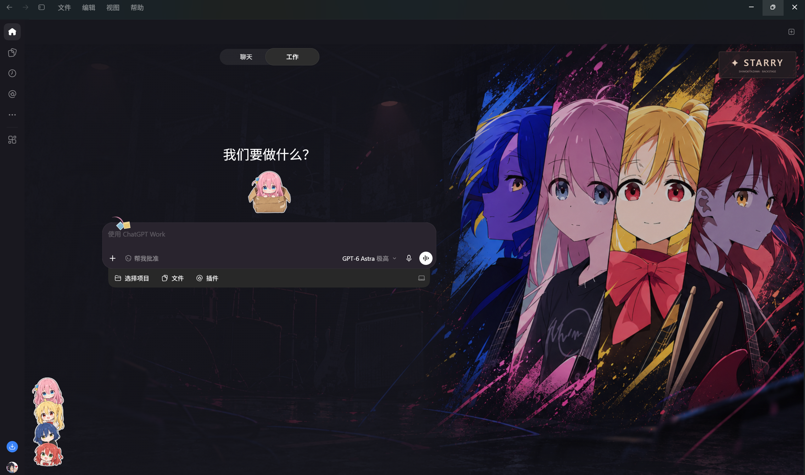

# 孤独摇滚 · Codex Theme

把下北泽的夜场，留在每天聊天和工作的窗口里。

这是一套适用于 Windows Codex 桌面客户端的同人主题。四款壁纸共用右上角的 **STARRY** 标牌切换，Chat 和 Work 会记住同一个选择；纸箱波奇、四人贴纸和输入框上的小发饰也一起保留。

| 下北泽夜场 | 四色肖像 · 夜场切片 |
| --- | --- |
|  |  |
| **演出散场 · 后台合影** | **波奇失重 · 乐器宇宙** |
|  |  |

上面是壁纸原图预览。实际界面会根据 Chat／Work、窗口宽度和右侧面板调整阅读遮罩与装饰位置。

## 实机演示

以下两张为实际客户端截图，按原始分辨率保留。

**Work 对话 · 演出散场**（2199 × 1260）

**Work 首页 · 四色肖像**（2559 × 1510）

截图保留了拍摄时的界面和主题制作对话。Chat／Work 的具体验证范围见 [验证记录](docs/验证记录.md)。

## 从这里开始

1. 在仓库的 **Releases** 页面下载 `Bocchi-Codex-Theme-2.3.0-public.1-windows-x64.zip`。
2. 把压缩包完整解压到一个准备长期保留、可以写入的文件夹，例如文档里的 `Bocchi-Codex-Theme`。不要直接在压缩包里运行。
3. 双击 **01-安装.cmd**。它会检查客户端版本、运行环境和素材，然后生成本机配置与桌面入口。
4. 双击 **02-启动主题.cmd**，或桌面的 **Bocchi Codex Theme**。第一次打开独立主题窗口时，可能需要在官方登录页登录一次。
5. 使用深色外观，在右上角点 **STARRY** 就能换壁纸。

安装完成后先保留解压目录，快捷方式会从这里加载主题。无需管理员权限，也不会添加开机启动。若 Windows 显示发布者未知，可以先查看源码、下载来源和校验值再决定是否运行，不需要关闭系统防护。

## 这一版适用于什么环境

| 项目 | 本版范围 |
| --- | --- |
| 发行版本 | 2.3.0-public.1 |
| 主题／加载器 | 2.3.0 ／ 1.0.3 |
| 系统 | Windows x64，Windows PowerShell 5.1 |
| 客户端应用版本 | **26.1007.71326** |
| Windows 安装包版本 | **26.1007.9446.0** |
| 外观 | 深色，左到右布局 |
| 运行环境 | 完整包已包含 Node.js v24.19.0 |

这里列的是实际适配的版本。客户端升级后，主题会先停下来保留原界面；等对应适配版更新即可。安装脚本会读取版本，通常不用自己查安装目录。

## 日常操作

| 想做的事 | 对应入口 |
| --- | --- |
| 打开主题窗口 | `02-启动主题.cmd` 或桌面入口 |
| 暂时隐藏主题，继续使用当前窗口 | `03-暂停主题.cmd` |
| 重新显示主题 | `04-恢复主题.cmd` |
| 结束主题会话，打开普通客户端 | `05-恢复原界面.cmd` |
| 换一张壁纸 | 点击右上角 **STARRY** |

壁纸选择会保存在本机。菜单支持键盘选择、Esc 和点击外部关闭；切换壁纸不需要刷新对话。小窗口会缩小四人贴纸；空间不足或有面板、弹窗时，装饰会让出阅读和操作位置。

完整步骤见 [使用说明](docs/使用说明.md)、[恢复与回退](docs/恢复与回退.md) 和 [常见问题](docs/常见问题.md)。

## 它是怎样加载的

启动器使用已安装的官方客户端，另开一个主题专用本地配置目录，通过只监听本机的调试连接加载样式和壁纸。它会核对客户端版本、窗口身份和页面标记；停止加载后，主题图层会移除。

主题本身不增加云端接口，不修改官方安装包、原有外观配置或系统代理。客户端正常的联网、登录和对话功能仍由客户端处理。更多细节见 [加载方式与目录](docs/加载方式与目录.md)。

## 源码与素材

程序代码使用 [MIT 许可](LICENSE)，保留了 [Codex Dynamic Skin](https://github.com/CCDawn/Codex-Dynamic-Skin) 的许可说明。Node.js 的完整许可随包附带，见 [第三方说明](THIRD_PARTY_NOTICES.md)。

壁纸和贴纸单独记录在 [素材说明](ASSETS.md)，不随程序的 MIT 许可一起授权。本项目是爱好者制作的主题，与 OpenAI 及《孤独摇滚》官方没有隶属关系。

从源码开始时，将同版本 Windows 完整包里的 `engine/node.exe` 放到源码的同名位置，再运行安装入口即可。构建和检查方法见 [开发与打包](docs/开发与打包.md)。

最近的修复和测试范围分别记录在 [更新记录](CHANGELOG.md) 与 [验证记录](docs/验证记录.md)。欢迎在 Issues 留下版本号、复现步骤和去掉个人内容的截图，我们可以一起慢慢把它打磨得更顺手。

