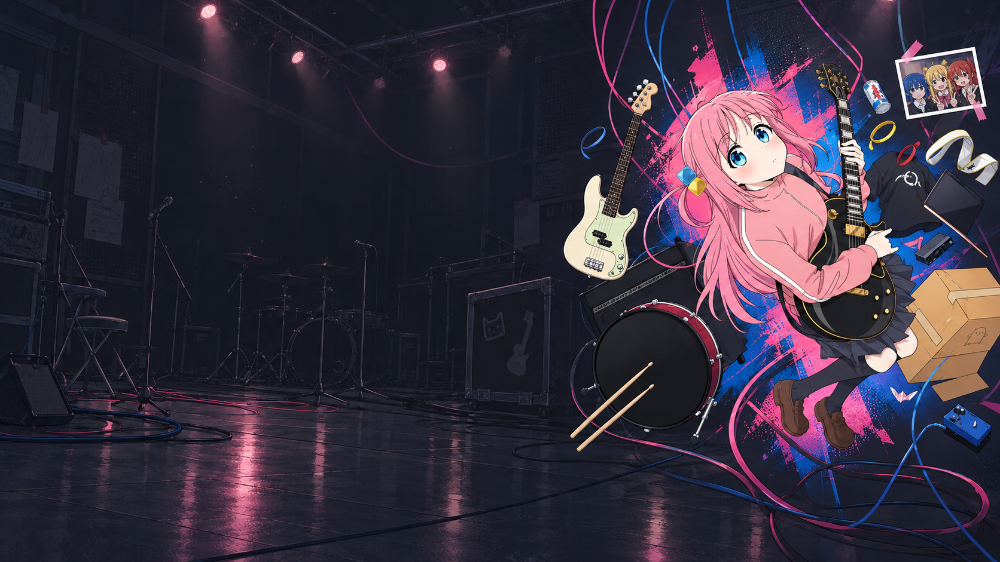

# 孤独摇滚 · Bocchi the Rock! Codex Theme

**简体中文 · [English](README.en.md)**

把结束乐队的小小夜场，留在每天聊天和工作的窗口里。这个《孤独摇滚》／波奇 Codex 桌面动漫主题，为 Windows 上的 Chat 与 Work 带来六款壁纸、STARRY 切换菜单和角色贴纸，也为正文留出安静的阅读空间。

A fan-made **Bocchi the Rock! anime theme for OpenAI Codex Desktop on Windows**: six wallpapers, a STARRY picker and comfortable Chat / Work reading. [Read the English guide →](README.en.md)

**[下载 Windows 完整包 / Download for Windows](https://github.com/Eltamako/bocchi-codex-theme/releases/latest)** · [安装说明](docs/使用说明.md) · [常见问题](docs/常见问题.md) · [恢复与回退](docs/恢复与回退.md)

> **2.6.1 适配：Windows x64 · Codex 26.1016.51333（安装包 26.1016.6573.0）。** 安装会检查版本。主题启动后会临时使用深色显示，原先是浅色、深色或跟随系统都可以。其他客户端版本、macOS 和 Linux 不在本版适配范围内。

## 先看看实机效果

*冬日候场 · Work 首页 / Winter Lights · Work home。*

*波奇失重 · Work 对话 / Bocchi in Orbit · Work conversation。两张都是用户授权公开的 2.4 实机截图，保留原始像素；不是 2.5 英文界面的截图，也不是模拟预览。*

## 三步开始

1. 在 [最新发行页](https://github.com/Eltamako/bocchi-codex-theme/releases/latest) 下载 **windows-x64.zip** 完整包，完整解压到准备长期保留、自己可以写入的文件夹。
2. 双击 **01-安装.cmd** 或 **Install.cmd**。检查通过后，桌面会出现 **Bocchi Codex Theme**。
3. 先保存草稿、等正在处理的工作结束并退出普通 Codex 窗口，再双击桌面入口或 **02-启动主题.cmd / Start.cmd**。完成登录、进入 Chat 或 Work，主题会自动使用深色显示；点右上角 **STARRY** 挑选壁纸。

运行环境已经包含在完整包里，无需另装 Node.js。首次使用主题专用窗口可能需要登录自己的账号。请保留解压目录；通常无需管理员权限，也不会添加开机启动。

如果首次登录耗时较长，完成登录后运行 **04-恢复主题.cmd / Resume.cmd** 即可。暂停主题后，窗口会恢复原外观；不会覆盖长期外观偏好。

GitHub 的 **Source code** 和发行页的 **source.zip** 用于查看源码与开发，不是完整安装包。详细步骤见 [使用说明](docs/使用说明.md)。

## 2.6.1 · 桌面入口与图片预览修复

- 升级时识别旧的“Codex · 孤独摇滚”桌面入口，核对启动命令及主题安装记录后备份，再迁移为 Bocchi Codex Theme，避免退出后误启旧版。不会改动同名但无法确认归属的快捷方式。
- 修复 Chat 打开图片时替换输入框导致壁纸被移除的问题，保留打开和关闭动画中的完整场景。
- 补齐收起侧边栏后独立标题区域的左上圆角。
- 桌面入口使用本机已验证 Codex 安装中的原应用图标，并保存本地副本，不再显示 PowerShell 图标；图标不随发行包分发。
- 保持六款壁纸、配色、渐变、人物取景和两张实机展示图；STARRY 不增加光晕。
- 适配范围不变：Windows x64，Codex 26.1016.51333／安装包 26.1016.6573.0。主题 2.6.1，加载器 1.2.1。版本不匹配保护保留。

## 新版 Codex 适配

适配新版 Codex 的页面布局，合并侧栏与标签面板切换的流畅度优化，并提供更具体的加载诊断。六款壁纸与已确认画面效果保持不变。旧版 Codex 26.1013.40934 请继续使用 [2.5.1](https://github.com/Eltamako/bocchi-codex-theme/releases/tag/v2.5.1)。[完整更新记录](CHANGELOG.md)

## 2.5 带来了什么

- 中文和英文共用同一个安装包；安装提示、STARRY 菜单和错误说明都有对应语言。
- 波奇单人款恢复暗灰紫底色，整体小幅下移，主图和环境一起对齐。
- 自动使用深色显示，暂停时恢复；首次登录或页面未就绪也有下一步说明。
- 保留六款壁纸选择记忆、正文阅读遮罩、输入框防漏与侧栏切换修复。

## 语言与日常入口

默认自动选择语言：安装工具跟随 Windows，STARRY 菜单优先跟随客户端。想手动选择时，打开 **06-语言设置.cmd / Language.cmd**，选择自动、简体中文或 English。这里只改变主题自己的文字，不会修改系统或官方客户端语言。

| 想做的事 | 中文入口 | English entry |
| --- | --- | --- |
| 安装、建立桌面入口 | 01-安装.cmd | Install.cmd |
| 打开主题窗口 | 02-启动主题.cmd | Start.cmd |
| 暂停主题，保留当前窗口 | 03-暂停主题.cmd | Pause.cmd |
| 恢复主题 | 04-恢复主题.cmd | Resume.cmd |
| 回到普通客户端 | 05-恢复原界面.cmd | Restore.cmd |
| 调整主题语言 | 06-语言设置.cmd | Language.cmd |

## 六款壁纸

| 下北泽夜场 / Shimokitazawa Nights | 四色肖像 / Four Colors, Four Portraits |
| --- | --- |
|  |  |
| **后台合影 / After the Show · Backstage** | **波奇失重 / Bocchi in Orbit** |
|  |  |
| **冬日候场 / Winter Lights** | **随身节拍 / Headphone Harmony** |
|  |  |

上面是原图；实际界面会按窗口尺寸、Chat／Work 模式和面板空间调整取景及阅读遮罩。

## 升级、兼容与反馈

升级时请把新版本解压到新文件夹，旧目录先保留。可以迁移壁纸选择，语言在新版里重新选择即可；不要复制旧的运行状态或整个登录目录。[升级与回退步骤](docs/恢复与回退.md)

本版使用 Windows PowerShell 5.1 与包内 Node.js v24.19.0。它通过本机调试连接加载主题，不修改官方安装包、系统代理或普通客户端外观配置。客户端更新后需要重新验证适配，改版本号本身不能完成适配。[加载方式](docs/加载方式与目录.md) · [验证范围](docs/验证记录.md)

遇到问题，欢迎在 [Issues](https://github.com/Eltamako/bocchi-codex-theme/issues) 留下主题版本、客户端版本、复现步骤和去掉个人内容的截图。无需上传整个本地数据目录。

## 许可与致谢

程序代码使用 [MIT 许可](LICENSE)，感谢 [Codex Dynamic Skin](https://github.com/CCDawn/Codex-Dynamic-Skin) 的基础工作。[第三方说明](THIRD_PARTY_NOTICES.md)

壁纸、贴纸及角色视觉素材不包含在代码 MIT 授权内；来源和授权记录的现有边界见 [素材说明](ASSETS.md)。本项目是非官方同人定制，与 OpenAI 及《孤独摇滚》官方没有隶属关系。

原始参考图片来源：X《孤独摇滚！》动画官方账号 [@BTR_anime](https://x.com/BTR_anime)（素材提供者说明）。壁纸包含 AI 扩图与后续修整，相关图片及角色版权归各自权利人所有。

[更新记录](CHANGELOG.md) · [版本选择](docs/版本选择.md) · [开发与打包](docs/开发与打包.md)

2.6.1 启动提醒：从托盘选择 Exit 后，可直接打开主题入口；启动器会等候退出完成。重复点击会等待已在进行的操作。新版请解压到独立文件夹，保留旧版用于回退。
